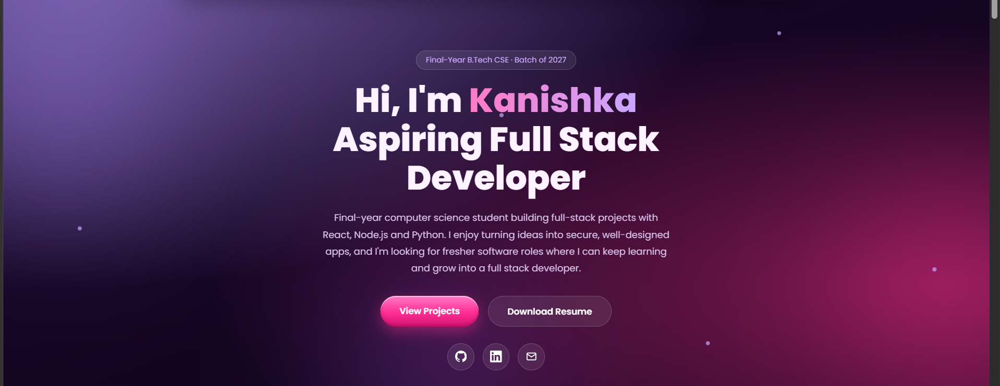

<div align="center">

# Kanishka Devi | Developer Portfolio

**Final-year B.Tech CSE student building practical, full-stack web applications.**

[](#tech-stack)
[](#tech-stack)
[](#tech-stack)

<!-- Live link ready hone par ye line add karo: [Live Portfolio](https://kanishka373.github.io) · -->
[GitHub](https://github.com/kanishka373) · [LinkedIn](https://www.linkedin.com/in/kanishka-d-516a31392/)

</div>

---

## About

Hi, I'm **Kanishka**, a final-year B.Tech Computer Science Engineering student (batch of 2027, CGPA 8.18). I enjoy understanding how applications work, solving problems and learning by building. I'm working towards becoming a full stack developer and I'm looking for fresher software roles.

## Preview

<p align="center">
  
</p>

## Features

- Lavender to dark-pink radial background with glassmorphism cards and glowing icons
- Auto-animated floating orbs and particles (no mouse-reactive effects)
- Glossy pink call-to-action buttons with a shine animation
- Fully responsive layout (desktop, tablet, mobile) with a mobile navigation menu
- Smooth scrolling and scroll-reveal animations
- Sections: Home, Skills, Projects, Education, Certifications, Highlights, Contact
- Projects, skills and certificates are rendered from simple JavaScript arrays, so adding a new entry is a one-place change
- Animated count-up numbers in the Highlights section

## Featured Projects

### 1. SchemaLens
Connects to a MySQL database and shows its structure as an interactive, draggable schema graph.

- Primary / foreign key relationships and relationship highlighting
- Table and column search, table details panel, zoom controls
- Backend reads `information_schema` to build the graph
- **Stack:** React, Vite, React Flow, Node.js, Express, MySQL

[Repository](https://github.com/kanishka373/SchemaLens)

### 2. ResuTrack
AI-powered Streamlit app that helps users analyze and improve resumes for Applicant Tracking Systems.

- AI resume scoring and missing-skill detection
- PDF report generation and resume comparison
- Multi-template resume builder
- Live trending-skills analytics and job search using the Adzuna API
- Resume history and dashboard
- **Stack:** Python, Streamlit, Groq AI, SQLite, PyPDF2, ReportLab, Plotly, Adzuna API

[Repository](https://github.com/kanishka373/Resutrack-AI)

### 3. PromptShield
Security tool that scans text and masks secrets (API keys, JWT tokens, passwords, database URIs, AWS keys) before they are shared with AI tools.

- 8 secret categories detected with a weighted risk score (0-100)
- Instant masking with safe placeholders and a live demo scanner
- JWT authentication with bcrypt password hashing
- Scan history with PDF / CSV export
- **Stack:** React, Vite, Node.js, Express, MongoDB

[Repository](https://github.com/kanishka373/PromptShield)

### 4. ExpenseFlow
Full-stack personal expense tracker where every user has their own account, budgets and saved history.

- JWT authentication with bcrypt password hashing
- Income and expense CRUD with filtering, search and sorting
- Monthly and category budgets
- Chart.js analytics and transaction data export
- **Stack:** HTML, CSS, JavaScript, Node.js, Express, PostgreSQL (Supabase), Chart.js

[Repository](https://github.com/kanishka373/Expense-Flow) · [Live Demo](https://expense-flowkd.netlify.app/)

### 5. VaultShift
Cyber-security-inspired web app for exploring basic cryptography through interactive text transformation.

- Caesar Cipher and Reverse Cipher with encryption and decryption workflows
- Encryption history, duplicate prevention and history deletion
- QR code generation, copy and download of encrypted results
- Matrix-style cyber UI
- **Stack:** Python, Flask, SQLite, HTML, CSS, JavaScript

### 6. Password Strength Checker
Web app for real-time password strength checking and secure credential storage.

- Real-time strength feedback and a strong password generator
- Dashboard showing weak / medium / strong counts
- Passwords stored as bcrypt hashes in SQLite
- Matrix-style neon rain UI
- **Stack:** Python, Flask, SQLite, HTML, CSS, JavaScript, bcrypt

## Tech Stack

| Area | Technologies |
| --- | --- |
| Languages | HTML, CSS, JavaScript, Python, Java, SQL |
| Frameworks & Libraries | React (basic), Node.js, Express, Bootstrap, Streamlit |
| Databases | MySQL, PostgreSQL (Supabase), SQLite, MongoDB |
| Tools | Git, GitHub, VS Code |
| Core Concepts | Data Structures & Algorithms, DBMS (basics), Operating Systems (basics) |

## Certifications

- Data Structures & Algorithms, Simplilearn
- HTML, CSS & Bootstrap, Great Learning
- SQL (Intermediate), HackerRank
- Python for Data Science, IBM
- AI for All, Infosys Springboard
- Data Science & Analytics, HP LIFE
- Coding & Programming, Samsung Innovation Campus
- Machine Learning Terminology, AWS
- Data Analytics, Deloitte
- GenAI Powered Data Analytics, Tata Group

## Project Structure

```
portfolio/
├── index.html      # page structure and content
├── style.css       # styling and responsive layout
├── script.js       # navbar, skills / projects / certificates data, scroll reveal
├── icons/          # SVG icons for skills and projects
└── images/         # README preview screenshot
```

## Run Locally

```bash
# clone the repository
git clone https://github.com/kanishka373/portfolio.git

# open the folder
cd portfolio

# open index.html in your browser
# (or use the VS Code "Live Server" extension)
```

No build step or dependencies required.

## Contact

- GitHub: [@kanishka373](https://github.com/kanishka373)
- LinkedIn: [Kanishka Devi](https://www.linkedin.com/in/kanishka-d-516a31392/)
- Email: kanishkakittu2@gmail.com

---

<div align="center">
Designed and built by Kanishka
</div>